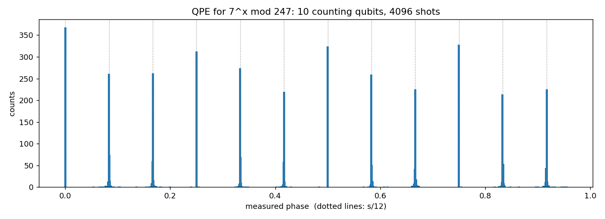
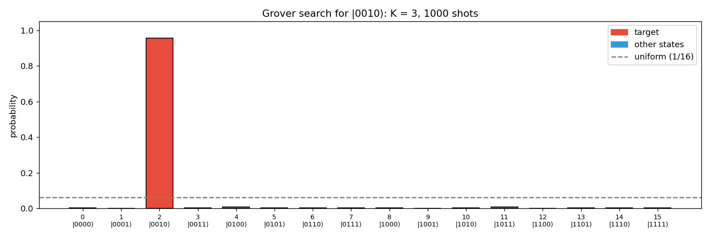
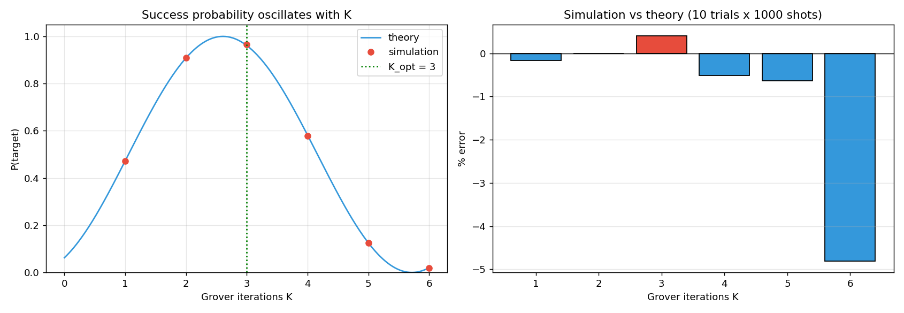

# Quantum Algorithms with Qiskit

Implementations of two foundational quantum algorithms, simulated with [Qiskit](https://www.qiskit.org/) and the Aer simulator.

| Notebook | Algorithm | What it does |
|---|---|---|
| [`shor/shors_algorithm.ipynb`](shor/shors_algorithm.ipynb) | **Shor's factorization** | Factors **247 = 13 × 19** using Quantum Phase Estimation + inverse QFT for order finding |
| [`grover/grover_search.ipynb`](grover/grover_search.ipynb) | **Grover's search** | Finds a marked state among 16 (4 qubits) with **~96% probability in 3 queries** |

---

## Shor's Algorithm

Factoring reduces to **order finding**: given `a` coprime to `N`, find the smallest `r` with `aʳ ≡ 1 (mod N)`. Then `gcd(a^(r/2) ± 1, N)` gives the factors. Quantum Phase Estimation finds `r` in polynomial time.

The notebook covers three parts:

1. **Classical baseline**: brute-force order finding for N = 247
2. **Gate-level QPE for N = 15**: modular multiplication built from SWAP and X gates, the circuit from the textbooks
3. **QPE for N = 247**: 18 qubits (10 counting + 8 work), with modular multiplication supplied as a permutation-matrix oracle. Recovers `r = 12` for `a = 7` via continued fractions and gets **247 = 13 × 19**



Peaks land on multiples of 1/12, which reveals the period r = 12.

---

## Grover's Search

Searches an unstructured space of N = 16 states for a target value (default `TARGET = 2`, any of 0–15 works).

- **Phase oracle**: X gates + multi-controlled Z flip the sign of the target amplitude
- **Diffuser**: inversion about the mean, `D = H⊗ⁿ (2|0⟩⟨0| − I) H⊗ⁿ`
- **Optimal iterations**: `K = ⌊π / 4θ⌋ = 3`, where `sin θ = 1/√N`



### Theory vs. simulation

Success probability follows `P(K) = sin²((2K+1)θ)`. It peaks at K = 3 and then falls as the state over-rotates past the target. Simulation (10 trials × 1000 shots) matches theory to within shot noise.



| K | Theory | Simulation |
|---|--------|-----------|
| 1 | 0.473 | 0.472 |
| 2 | 0.908 | 0.908 |
| **3** | **0.961** | **0.965** |
| 4 | 0.582 | 0.579 |
| 5 | 0.126 | 0.125 |

---

## Running locally

```bash
pip install -r requirements.txt
jupyter notebook
```

Run notebooks from inside their folder (`shor/` or `grover/`); figures are saved to `images/`.

## Background

Built for a quantum computing course (COT 4601) and later cleaned up and extended.
